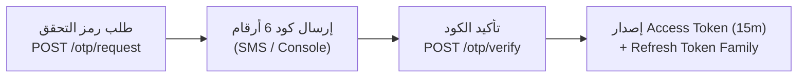

# توثيق واجهات برمجة التطبيقات (API Reference)
# API Specification & Endpoints Overview

يقوم الخادم بتوليد وثائق تفاعلية متوافقة مع OpenAPI 3.0 عبر المسار `/docs` في البيئات التطويرية.

> **ملاحظة مالية:** جميع المبالغ المالية يتم تبادلها وحسابها كأرقام صحيحة بالقروش (`100 kuruş = 1 TRY`). التواريخ بصيغة UTC ISO 8601.

---

## 1. المصادقة والعملاء (Authentication & Users)



- `POST /api/v1/auth/customer/otp/request`:
  - **الوظيفة:** طلب رمز تحقق جديد لرقم الهاتف عبر SMS.
  - **المدخلات (Body):** `{ "phone": "+905551112233" }`
  - **الأمان:** محمي بمعدل طلبات في Redis لمنع السبام.
- `POST /api/v1/auth/customer/otp/verify`:
  - **الوظيفة:** تأكيد كود الـ OTP المكون من 6 أرقام.
  - **المدخلات (Body):** `{ "phone": "+905551112233", "code": "123456" }`
  - **المخرجات:** رمز الدخول المؤقت للعميل (15 دقيقة) وتعيين توكن التحديث المشفر.
- `POST /api/v1/auth/staff/login`:
  - **الوظيفة:** تسجيل دخول موظفي المطعم والمدير.
  - **المدخلات (Body):** `{ "email": "owner@kardeslercihangir.com", "password": "...", "totp_code": "123456" }`
  - **الأمان:** تشفير Argon2id + رمز المصادقة الثنائية TOTP الإلزامي.
- `DELETE /api/v1/users/me`:
  - **الوظيفة:** حذف الحساب وتجهيل البيانات وفقاً لقانون الـ KVKK.

---

## 2. قائمة الطعام العامة (Menu Catalog)

- `GET /api/v1/menu`:
  - **الوظيفة:** جلب قائمة الطعام الكاملة المصنفة (كباب، شاورما، مقبلات، حلويات) مع الإضافات ومسببات الحساسية.
  - **الترويسة (Headers):** `Accept-Language: tr` (أو `ar`, `en`).
  - **الأداء:** مُخزنة في ذاكرة الـ Redis مع تحديثها فورياً عند أي تعديل إداري.

---

## 3. محرك التسعير وحساب السلة (Pricing Engine)

- `POST /api/v1/cart/price`:
  - **الوظيفة:** الحساب النهائي المعتمد للأسعار على السيرفر (لا يُسمح للتطبيق بإرسال مبالغ نهائية).
  - **المدخلات (Body):**
    ```json
    {
      "items": [
        {
          "menu_item_id": "uuid-adana-kebab",
          "quantity": 2,
          "option_ids": ["uuid-option-1.5-portion"]
        }
      ],
      "coupon_code": "HOSGELDIN",
      "address_id": "uuid-customer-address"
    }
    ```
  - **المعالجة:**
    1. التأكد من فتح المطعم وقبوله للطلبات (`is_accepting_orders = true`).
    2. التأكد من توفر جميع الوجبات والإضافات المختارة وعدم نفادها.
    3. فحص وقوع إحداثيات العنوان الجغرافي داخل أحد نطاقات التوصيل عبر PostGIS.
    4. تطبيق الخصم واحتساب الحد الأدنى للطلب **بعد الخصم** بالقروش.

---

## 4. دورة حياة الطلبات (Orders Lifecycle)

- `POST /api/v1/orders`:
  - **الوظيفة:** إنشاء طلب جديد برقم تسلسلي يومي ومفتاح فريد لمنع التكرار (`idempotency_key`).
- `GET /api/v1/orders/my`:
  - **الوظيفة:** جلب سجل طلبات العميل الحالي مع الخط الزمني للتوصيل.
- `POST /api/v1/orders/:id/reorder`:
  - **الوظيفة:** إعادة طلب نفس الوجبات السابقة بضغطة زر واحدة بأسعار اليوم المحدثة.
- `PATCH /api/v1/orders/:id/status` (صلاحيات موظفي المطعم):
  - **الوظيفة:** نقل الطلب بين الحالات المسموحة (`accepted`, `on_the_way`, `delivered`, `cancelled`).
  - **التأثير:** إرسال إشعار فوري للوحة الإدارة وإضافة أمر جديد لقائمة طباعة المطبخ.

---

## 5. البث الحي ووكيل الطباعة (Live Stream & Thermal Printing)

- `GET /api/v1/admin/orders/stream`:
  - **الوظيفة:** قناة بث حي (Server-Sent Events) للوحة تحكم المطبخ لإصدار إنذار صوتي فوري عند وصول أي طلب جديد.
- `GET /api/v1/print/jobs/poll` & `POST /api/v1/print/jobs/:id/ack`:
  - **الوظيفة:** قناة اتصال لوكيل الطباعة المحلي لاستقبال تفاصيل البون وطباعته على طابعة المطبخ SUNLUX RP8020.
