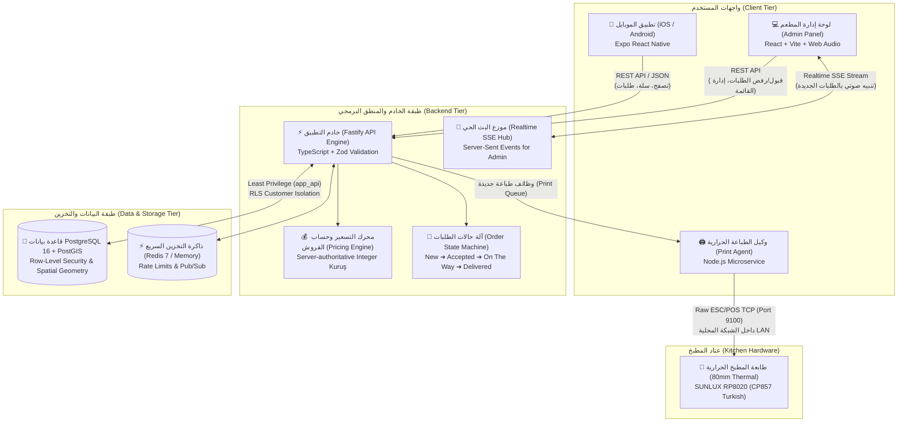
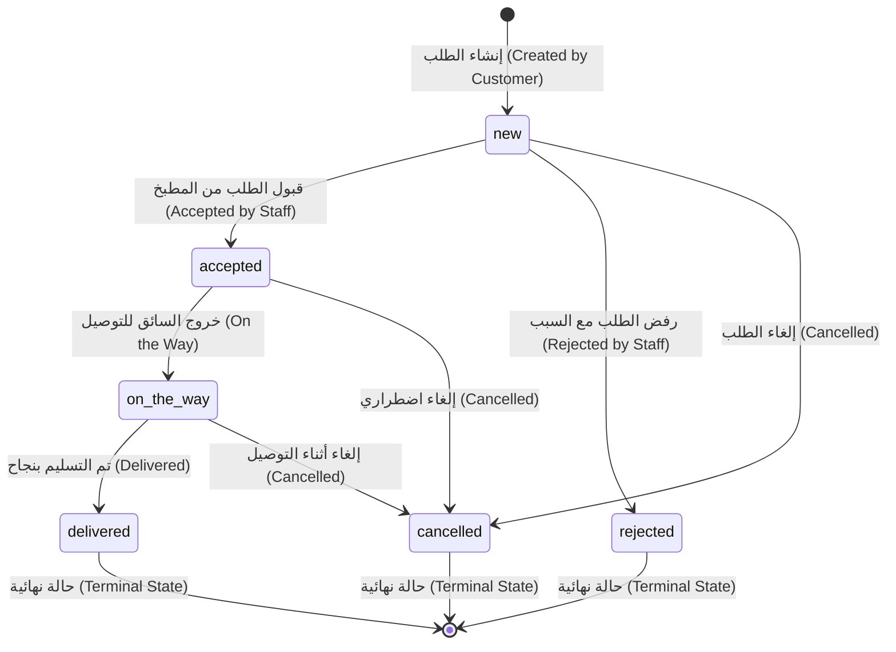
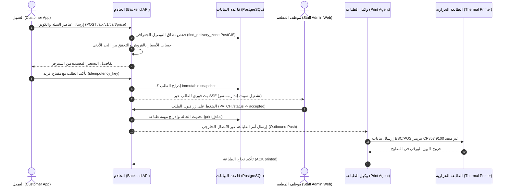

# هيكلية النظام والتصميم العام للمشروع
# System Architecture & Monorepo Design

يوضح هذا المستند الهيكلية الشاملة لنظام طلب الطعام الخاص بمطعم **Kardeşler Cihangir**، مصمماً بنمط الـ Monorepo لربط تطبيق الهاتف، لوحة تحكم الإدارة، الخادم، الطابعة الحرارية في المطبخ، وقاعدة البيانات.

---

## 1. المخطط العام للنظام (System Architecture Flowchart)

---

## 2. دورة حياة الطلب وحالاته (Order Lifecycle State Machine)

---

## 3. تسلسل عملية الطلب والطباعة الفورية (Order Placement & Kitchen Ticket Sequence)

---

## 4. مكونات حزمة المشروع (Monorepo Modules Overview)

| المسار (Directory) | المكون (Component) | الوصف التقني والوظيفة |
| :--- | :--- | :--- |
| **`database/`** | قاعدة البيانات (PostgreSQL + PostGIS) | المصدر المرجعي الأول للبيانات (Source of Truth)، يحتوي على 7 ملفات ترحيل تضمن الأمان وعزل البيانات بالـ RLS. |
| **`packages/shared/`** | الحزمة المشتركة (Shared Package) | مخططات Zod المشتركة، حسابات القروش، الثوابت، اللغات المدعومة (`tr`, `en`, `ar`). |
| **`backend/`** | الخادم البرمجي (Backend API) | مبني بـ Fastify و Drizzle ORM ومحرك التسعير الصارم (Server-authoritative Pricing). |
| **`admin/`** | لوحة تحكم الإدارة (Admin Web) | واجهة React سريعة مع تنبيهات صوتية عالية لا تتوقف حتى يقبل الموظف الطلب. |
| **`mobile/`** | تطبيق الموبايل (Mobile App) | تطبيق Expo React Native يدعم التركية والإنجليزية والعربية (مع محاذاة RTL). |
| **`print-agent/`** | وكيل الطباعة (Print Agent) | خدمة تعمل محلياً وترسل البونات بترميز CP857 لطابعة SUNLUX عبر الشبكة الداخلية. |
| **`docs/`** | التوثيق الفني (Documentation) | توثيق كامل للهيكلية، الأمان، استراتيجية التشغيل، والافتراضات مع الترجمة العربية. |
