# الدليل الشامل لقاعدة بيانات مطعم كاردشلار جيهانجير (PostgreSQL 16 + PostGIS)
# Kardeşler Cihangir Database Schema & Entity Relationship Guide

هذا الدليل يشرح بالتفصيل المعماري كل جدول في قاعدة البيانات، وظيفته، حقوله، علاقاته بالجداول الأخرى، والقيود الصارمة المفروضة عليه برمجياً لضمان النزاهة المالية والأمنية لنظام مطعم **Kardeşler Cihangir** في إسطنبول.

---

## 1. المخطط البياني للعلاقات (Entity-Relationship Diagram - ERD)

المخطط التالي يوضح خريطة العلاقات بين كافة الجداول الأساسية في النظام:

```mermaid
erDiagram
    users ||--o{ orders : "يملك طلبات"
    users ||--o{ addresses : "يملك عناوين توصيل"
    users ||--o{ devices : "يسجل أجهزة"
    users ||--o{ consents : "يمنح موافقات قانونية"
    users ||--o{ refresh_tokens : "يملك جلسات"
    users ||--o{ coupon_redemptions : "يستخدم كوبونات"
    users ||--o{ loyalty_ledger : "يجمع نقاط ولاء"
    users ||--o{ reviews : "يكتب تقييمات"
    users ||--o{ referrals : "يدعو / يُدعى"

    delivery_zones ||--o{ orders : "يحدد نطاق التوصيل والحد الأدنى"
    drivers ||--o{ orders : "يوصل الطلب"

    categories ||--|{ category_translations : "يترجم إلى TR, EN, AR"
    categories ||--o{ menu_items : "يحتوي أصنافاً"

    menu_items ||--|{ menu_item_translations : "يترجم إلى TR, EN, AR"
    menu_items ||--o{ menu_item_tags : "يُصنف بـ"
    tags ||--o{ menu_item_tags : "يصنف وجبات"
    tags ||--|{ tag_translations : "يترجم إلى TR, EN, AR"

    menu_items ||--o{ option_groups : "يمتلك مجموعات خيارات"
    option_groups ||--|{ option_group_translations : "يترجم إلى TR, EN, AR"
    option_groups ||--|{ options : "يحتوي خيارات"
    options ||--|{ option_translations : "يترجم إلى TR, EN, AR"

    menu_items ||--o{ price_history : "يسجل تغير الأسعار"
    staff_users ||--o{ price_history : "يغير السعر"

    orders ||--|{ order_items : "يتكون من أسطر أصناف"
    order_items ||--o{ order_item_options : "يتضمن خيارات مخصصة"
    orders ||--|{ order_events : "يسجل دورة حياة وتاريخ الطلب"
    orders ||--o{ payments : "يسجل مدفوعات إلكترونية / كاش"
    orders ||--o{ print_jobs : "يولد مهام طباعة لبون المطبخ"
    orders ||--o| coupon_redemptions : "يطبق كود خصم واحد"

    coupons ||--o{ coupon_redemptions : "يسجل مرات الاستخدام"
    coupons ||--o{ coupon_categories : "يستهدف فئات معينة"
    coupons ||--o{ coupon_menu_items : "يستهدف وجبات معينة"

    staff_users ||--o{ audit_logs : "يسجل حركات المشرفين"
    staff_users ||--o{ refresh_tokens : "يملك جلسات لوحة التحكم"
```

---

## 2. تفصيل الجداول حسب النطاق الوظيفي (Domains)

---

### النطاق الأول: إعدادات المطعم والمناطق الجغرافية (Restaurant & Geographic Logistics)

#### 1. `restaurant_settings` (إعدادات المطعم الفردي)
- **الهدف:** تخزين إعدادات الفرع الوحيد للمطعم (Singleton Pattern). يمنع التكرار نهائياً عبر قيد `CHECK (id = 1)`.
- **أهم الأعمدة:**
  - `is_accepting_orders`: مفتاح طوارئ لإيقاف استقبال الطلبات فوراً في حال الضغط بالمطبخ.
  - `opening_hours` (`jsonb`): ساعات العمل لكل يوم أسبوعي بدقة.
  - `business_day_cutoff` (`time`): توقيت إغلاق اليوم المحاسبي (الافتراضي `06:00` صباحاً بتوقيت إسطنبول لأن المطعم يعمل بعد منتصف الليل).
  - `min_app_version`: إجبار الهواتف على التحديث عند وجود تغييرات جذرية.
- **الحماية:** محمي بتريجر يمنع الحذف نهائياً (`fn_prevent_mutation`).

#### 2. `delivery_zones` (نطاقات التوصيل الجغرافية عبر PostGIS)
- **الهدف:** تحديد المضلعات الجغرافية لمناطق التوصيل في إسطنبول (جيهانجير، تقسيم، قره كوي). التوصيل مجاني دائماً، ولكن لكل منطقة حد أدنى مالي خاص بها.
- **أهم الأعمدة:**
  - `area` (`geography(Polygon, 4326)`): مضلع جغرافي دقيق بنظام الإحداثيات العالمي WGS84.
  - `min_order_kurus`: الحد الأدنى للطلب بالقروش (مثلاً 25,000 = 250 ليرة تركية).
  - `estimated_minutes`: وقت التوصيل التقديري.
- **العلاقات:**
  - يرتبط مع `orders.delivery_zone_id` كـ `ON DELETE RESTRICT` (ممنوع حذف منطقة مسجل عليها طلبات تاريخية).
- **الدوال الذكية:**
  - دالة `find_delivery_zone(lat, lng)` تقوم بالبحث المكاني الفوري بنظام الـ R-Tree عبر فهرس `GIST(area)`.

#### 3. `drivers` (طيارو التوصيل التابعين للمطعم)
- **الهدف:** إدارة أسطول السائقين الخاص بالمطعم.
- **أهم الأعمدة:** `name`, `phone` (صيغة E.164), `vehicle_plate`, `is_active`.
- **العلاقات:** يرتبط مع `orders.driver_id` كـ `ON DELETE SET NULL`.

---

### النطاق الثاني: المستخدمون والأمان والامتثال القانوني (Users, Auth & Compliance)

#### 4. `users` (سجل الزبائن والعملاء)
- **الهدف:** ملف العميل في تطبيق الموبايل، متوافق بنسبة 100% مع قانون حماية البيانات التركي KVKK وحذف الحسابات لشروط Google/Apple.
- **أهم الأعمدة:**
  - `phone`: رقم الهاتف الفريد بصيغة E.164 (فهرس فريد جزئي يستثني الحسابات الممسوحة).
  - `referral_code`: كود الإحالة الخاص بالعميل (مُولد بقيمة فريدة).
  - `referred_by_user_id`: الحساب الذي دعا هذا العميل.
  - `anonymized_at`: توقيت تطهير الهوية وحذف الحساب تحت KVKK.
- **العلاقات:**
  - يرتبط مع كافة جداول العميل (`orders`, `addresses`, `devices`, `loyalty_ledger`, `reviews`).
- **الحماية والأمان (RLS):**
  - جدول محمي بـ `FORCE ROW LEVEL SECURITY`. العميل لا يستطيع برمجياً قراءة أو تعديل أي سجل يخص عميلاً آخر (`id = app_user_id()`).

#### 5. `staff_users` (موظفو وإدارة المطعم)
- **الهدف:** إدارة حسابات لوحة التحكم بالمطعم.
- **أهم الأعمدة:**
  - `email` (`citext`): بريد فريد غير حساس لحالة الأحرف.
  - `password_hash`: مشفر حصراً بخوارزمية Argon2id أو Bcrypt.
  - `role`: محصور في (`owner` أو `staff`). المشرف يرى ويقبل الطلبات فقط، والمالك يعدل المنيو والتقارير.
  - `totp_secret_encrypted`: سر التحقق بخطوتين (2FA) مشفر بأحدث المعايير.
- **الأمان:** محجوب تماماً عن أي سياق عميل أو مستخدم عام (يرجع 0 صفوف لـ `customer`).

#### 6. `otp_codes` (رموز تسجيل الدخول السريعة)
- **الهدف:** تسجيل الدخول برقم الموبايل بكلمة مرور لمرة واحدة صالحة لمدة 5 دقائق.
- **أهم الأعمدة:** `phone`, `salt` (ملح تشفير عشوائي لكل كود لمنع Rainbow Tables), `code_hash`, `attempts` (حد أقصى 5 محاولات لمنع التخمين), `consumed_at`.

#### 7. `refresh_tokens` (جلسات الدخول وتدوير التوكنات)
- **الهدف:** الحفاظ على بقاء تسجيل دخول العميل والموظف مع حماية عائلة التوكنات (Token Rotation Families) لكشف السرقة فورا وإلغاء الجلسات المتضررة.

#### 8. `addresses` (عناوين التوصيل المحفوظة)
- **الهدف:** العناوين المسجلة للزبائن مع حفظ الإحداثيات الجغرافية كـ `Point` بـ PostGIS لتحديد أقرب منطقة توصيل بدقة المتر.
- **العلاقات:** يرتبط بـ `users.id` بـ `ON DELETE CASCADE`.

#### 9. `consents` (سجل الموافقات القانونية - Append Only)
- **الهدف:** توثيق شروط الخدمة، سياسة الخصوصية، وموافقات الإعلانات SMS طبقاً لـ İYS و KVKK في تركيا.
- **الحماية:** جدول تراكمي يمنع الـ `UPDATE`, `DELETE`, و `TRUNCATE`.

---

### النطاق الثالث: قائمة الطعام متعددة اللغات (Multilingual Menu & Catalog)

قاعدة بيانات المنيو مبنية وفق معيار **Strict Multilingual Separation**: الجداول الأساسية تحتوي المعرفات والأسعار والأرقام فقط، وجداول الترجمة المنفصلة تحتوي النصوص بـ 3 لغات (**tr** التركية الإلزامية، **en** الإنجليزية، **ar** العربية).

#### 10. `categories` & `category_translations` (فئات المنيو)
- فئات المنيو (مشويات، سندوتشات، فطائر ولحم بعجين، إفطار، مقبلات وسلطات، مشروبات وحلويات).
- **القيد الصارم:** تريجر ثنائي الاتجاه يمنع حفظ الفئة أو حذف ترجمتها دون وجود ترجمة تركية صالحة (`language = 'tr'`).

#### 11. `tags` & `tag_translations` & `menu_item_tags` (شارات الوجبات)
- شارات مثل: "الأكثر مبيعاً 🔥", "اختيار الشيف ⭐", "حار 🌶️", "نباتي 🍃".
- علاقة أطراف بأطراف (Many-to-Many) عبر `menu_item_tags`.

#### 12. `menu_items` & `menu_item_translations` (أصناف الوجبات والأسعار)
- **أهم الأعمدة:**
  - `price_kurus` (`bigint`): سعر الوجبة مخزن بالقروش التركية الصحيحة (مثلاً كباب أضنة 340 ليرة = `34000`). لا نستخدم `FLOAT` لمنع أخطاء التقريب المالي.
  - `vat_rate_percent`: نسبة ضريبة القيمة المضافة KDV في تركيا (1% أو 10%).
  - `allergens` (`text[]`): مصفوفة مسببات الحساسية (جلوتين، مكسرات، سمسم، لاكتوز).
  - `deleted_at`: حذف ناعم (Soft Delete).
- **الحماية:** ممنوع حذف الوجبة نهائياً (`ON DELETE RESTRICT`) في حال تم بيعها سابقاً لحماية الأرشيف المالي للضرائب.

#### 13. `option_groups` & `options` وترجماتها (خيارات الوجبات والأحجام)
- **الهدف:** تخصيص الوجبة، مثل:
  - حجم الوجبة (1 وجبة: +0 ليرة، 1.5 وجبة: +160 ليرة).
  - تفضيلات البصل والبهارات (بصل بالسماق، بدون بصل، فلفل مشوي إضافي).
- **أهم الأعمدة:**
  - `min_select` و `max_select`: إجبار العميل على اختيار حجم واحد كحد أدنى وأقصى في الخيارات الإلزامية.
  - `price_delta_kurus`: فرق السعر بالقروش (+ أو 0).

#### 14. `price_history` (تاريخ وسجل تغير الأسعار - Append Only)
- **الهدف:** تريجر آلي يرصد أي تعديل في سعر أي صنف في `menu_items` ويسجل السعر القديم، السعر الجديد، وهوية الموظف المسؤول مع التاريخ والوقت.

---

### النطاق الرابع: الطلبات والمحاسبة والطباعة (Orders, Integrity & Print Engine)

هذا هو قلب النظام والمستودع المالي للشركة.

#### 15. `orders` (الطلبات الرئيسية)
- **أهم الأعمدة المالية والحالات:**
  - `status`: آلة حالات صارمة (State Machine) محصورة في:
    `new` ➡️ `accepted` ➡️ `on_the_way` ➡️ `delivered` (أو `cancelled` / `rejected`).
  - `business_date`: تاريخ يوم العمل المحاسبي مع الأخذ بالاعتبار العمل لما بعد منتصف الليل (طلب الساعة 01:30 فجر الأربعاء يسجل محاسبياً في يوم الثلاثاء لأن الإغلاق الساعة 06:00 صباحاً).
  - `order_number`: ترقيم تسلسلي يومي ذري يبدأ من 1 لكل يوم عمل (`next_order_number()`).
  - `idempotency_key`: مفتاح منع تكرار الطلب في حال ضعف شبكة الهاتف وضغط العميل مرتين.
  - `subtotal_kurus`: مجموع ثمن الأصناف.
  - `discount_kurus`: قيمة الخصم.
  - `total_kurus`: الإجمالي النهائي المدفوع.
  - `customer_name_snapshot` و `customer_phone_snapshot`: لقطات نصية لبيانات العميل لحظة الطلب تظل محفوظة حتى لو عدل العميل ملفه لاحقاً.
- **الحماية الصارمة والتريجرات:**
  - **تريجر الحصانة المالية (`trg_orders_immutability`):** بمجرد إنشاء الطلب، يمنع منعاً باتاً تعديل أرقام القروش المالية، أو طريقة الدفع، أو العميل، أو المنطقة، أو رقم الطلب.
  - **تريجر تطابق الأصناف المالي (`trg_deferred_order_subtotal_integrity`):** يتحقق فوراً عند الـ `COMMIT` أن الـ `subtotal_kurus` يساوي بالمليم مجموع أسطر الأصناف التابعة له؛ يمنع أي تزوير.
  - **تريجر فرض القيم الافتراضية للعميل (`trg_orders_enforce_defaults`):** يجبر أي طلب من العميل على أن يبدأ بـ `status = 'new'` ويحسب التاريخ التسلسلي ورقم الطلب آلياً ويمنع حقن حالات منتهية.

#### 16. `order_items` & `order_item_options` (أصناف الطلب وخياراتها)
- **الهدف:** تسجيل الأصناف المشتراة بأسعارها ونسب ضرائبها لحظة الشراء.
- **الحماية:** أسطر غير قابلة للتعديل أو المسح نهائياً بمجرد إدراجها. لا يمكن إدراج أصناف لطلب حالته ليست `new`.

#### 17. `order_events` (سجل دورة حياة الطلب - Append Only)
- **الهدف:** يسجل كل حركة على الطلب بالتاريخ والوقت مع نوع ومنفذ الحركة (`customer`, `staff`, `driver`, `system`). الجدول Append-Only ويخضع لـ RLS صارم لمنع تزوير الأحداث بين العملاء.

#### 18. `payments` (سجلات المدفوعات)
- **الهدف:** توثيق حركة الدفع: إما بطاقة بنكية أونلاين عبر المزودين الأتراك (iyzico أو PayTR) مع حفظ رمز العملية دون لمس أرقام البطاقات الحساسة، أو الدفع عند الاستلام كاش (`cash_on_delivery`).

#### 19. `print_jobs` (طابور طباعة بون المطبخ الحراري)
- **الهدف:** طباعة فورية على طابعة المطبخ (SUNLUX RP8020 عبر كابل الشبكة LAN بأوامر ESC/POS بترميز تركي CP857).
- بمجرد قبول الطلب من الموظف، يولد تريجر مهمة في هذا الجدول ليلتقطها الـ `print-agent` فوراً.

---

### النطاق الخامس: التسويق والولاء والمراجعات (Marketing, Loyalty & Reviews)

#### 20. `coupons` (أكواد الخصم الترويجية)
- **أهم الأعمدة:**
  - `type`: إما نسبة مئوية (`percent`) أو مبلغ كاش (`fixed_amount`).
  - `max_discount_kurus`: سقف الخصم الأقصى لحماية المطعم من الخصومات الضخمة.
  - `min_order_kurus`: الحد الأدنى للطلب لتفعيل الكوبون.
  - `first_order_only`: قصر الكوبون على أول طلب فقط للعميل لمنع استغلال العروض الترحيبية.
  - `active_hours`: ساعات تفعيل الكوبون اليومية (مثل كوبونات الغداء).

#### 21. `coupon_redemptions` (سجل استخدام الكوبونات)
- **الهدف:** توثيق استخدام الكود لكل طلب.
- **القواعد:** قيد فريد صارم `UNIQUE(order_id)` يمنع دمج أكثر من كوبون في أوردر واحد.
- **الدالة:** دالة `redeem_coupon` تقوم بحساب الخصم داخلياً والتحقق من الشروط وقفل السطر لتفادي السباق الزمني. إذا أُلغي الطلب لاحقاً يُعاد الكوبون للزبون تلقائياً.

#### 22. `loyalty_ledger` & `loyalty_balances` (نقاط الولاء التراكمية)
- **الهدف:** نظام مكافأة الزبائن بدلاً من منصات التوصيل الوسيطة؛ يسجل كل إضافة أو خصم نقاط في جدول تراكمي غير قابل للحذف.
- الـ View باسم `loyalty_balances` يقوم بتجميع رصيد العميل اللحظي بـ SQL سريع.

#### 23. `referrals` (برنامج إحالة الأصدقاء)
- دعوة صديق بكود الإحالة؛ عند تسليم أول طلب للصديق المدعو بنجاح، تُمنح المكافأة للطرفين.

#### 24. `reviews` (التقييمات والآراء)
- تقييم الزبائن من 1 إلى 5 نجوم بعد اكتمال الطلب، مع دعم رد إدارة المطعم وموافقة النشر.

#### 25. `audit_logs` (سجل تدقيق النظام الأمني الشامل - Append Only)
- **الهدف:** تسجيل أي عملية DML تجري على إعدادات المطعم، أسعار الوجبات، الموظفين، أو مناطق التوصيل.
- **الحماية:** محمي برمجياً من التعديل والمسح والـ TRUNCATE، ومحمي من اختطاف مسار البحث، ويتم تفريغه تلقائياً من أي كلمات مرور أو مفاتيح سرية.

---

## 3. ملخص سلوك المفاتيح الخارجية (Foreign Keys Constraints & Integrity)

| المفتاح الأجنبي (Foreign Key) | من جدول | إلى جدول | السلوك عند الحذف (`ON DELETE`) | المبرر والسبب الهندسي |
| :--- | :--- | :--- | :--- | :--- |
| `user_id` | `orders` | `users` | **`SET NULL`** | إذا طلب العميل مسح حسابه (KVKK)، تُفرغ هويته وتُحفظ السجلات المالية لحسابات الضرائب. |
| `delivery_zone_id` | `orders` | `delivery_zones` | **`RESTRICT`** | يمنع حذف أي منطقة جغرافية ارتبطت بطلبات تاريخية. |
| `menu_item_id` | `order_items` | `menu_items` | **`RESTRICT`** | يمنع مسح وجبة تم بيعها سابقاً نهائياً للحفاظ على سلامة الفواتير؛ يُستخدم الحذف الناعم فقط. |
| `order_id` | `order_items` | `orders` | **`CASCADE`** | أسطر الأصناف تتبع الطلب وتُمسح فقط إذا سقط الطلب في مرحلة الإنشاء. |
| `order_id` | `coupon_redemptions` | `orders` | **`CASCADE`** | ترتبط عملية استخدام الكوبون مباشرة بالطلب. |
| `referrer_user_id` | `referrals` | `users` | **`RESTRICT`** | يمنع مسح وسيط الدعوة لوجود ترابط مالي ومكافآت معلقة. |

---

## 4. كيفية استعراض الجداول والمخطط عملياً في pgAdmin

1. في **pgAdmin**، اتصل بسيرفر:
   - **Host:** `localhost`
   - **Port:** `5434`
   - **Database:** `kardesler_db`
   - **User:** `postgres`
2. افتح المسار التالي في الشجرة الجانبية:
   `kardesler_db` ⬅️ `Schemas` ⬅️ `public`.
3. **لعرض المخطط البياني التفاعلي الكامل:**
   - اضغط **كليك يمين** على كلمة **public**.
   - اختر **Generate ERD** (أو اختصار `Ctrl + Shift + E`).
   - سيقوم pgAdmin برسم جميع الجداول الـ 44 والروابط والعلاقات بينها بالكامل في نافذة رسومية تفاعلية.
4. **لاستعراض بيانات الوجبات الحقيقية المسجلة:**
   - اضغط كليك يمين على جدول `menu_items` أو `menu_item_translations`.
   - اختر **View/Edit Data** ⬅️ **All Rows**.

