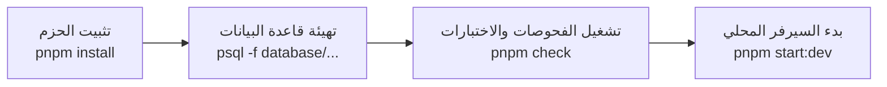
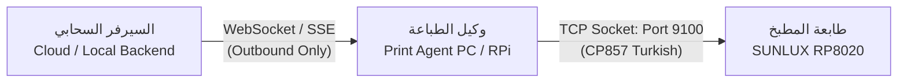

# دليل التشغيل وإجراءات الصيانة
# Operations Runbook & Deployment Guide

يوضح هذا الدليل خطوات التشغيل المحلي، صيانة النظام، وإجراءات الطوارئ وإعداد طابعة المطبخ الحرارية لمطعم **Kardeşler Cihangir**.

---

## 1. التشغيل المحلي للمطور (Local Developer Quickstart)

> **بدون دوكر (No Docker Required):** بما أنك المطور الأساسي للنظام، يعمل المشروع مباشرة باستخدام Node.js و PostgreSQL المثبتين على جهازك.



### خطوات التشغيل المباشر:
1. **تثبيت حزم الـ Monorepo:**
   ```bash
   pnpm install
   ```
2. **تطبيق ملفات الهجرة والاختبارات في قاعدة البيانات:**
   ```bash
   pnpm run db:migrate
   pnpm run db:test
   ```
3. **تشغيل الخادم البرمجي (Backend):**
   ```bash
   cd backend
   pnpm run start:dev
   ```
4. **تشغيل لوحة تحكم الإدارة (Admin Panel):**
   ```bash
   cd admin
   pnpm run dev
   ```

---

## 2. إعداد طابعة المطبخ الحرارية (SUNLUX RP8020 Configuration)



### الأمان والعزل الشبكي:
- **قاعدة أمان صارمة:** منفذ الطابعة `9100` **ممنوع تماماً أن يكون مكشوفاً للإنترنت**. الطابعة متصلة حصرياً بالشبكة المحلية (LAN) الخاصة بالمطعم.
- يتم إعطاء الطابعة عنوان IP ثابت (Static IP) داخل الراوتر (مثال: `192.168.1.200`).

### تشغيل وكيل الطباعة:
يعمل وكيل الطباعة على جهاز كمبيوتر أو راك المطبخ (أو Raspberry Pi):
```bash
cd print-agent
pnpm install

# فحص الأحرف التركية الخاصة (ğ, ş, İ, ı, ç, ö, ü) عبر طباعة بون تجريبي
pnpm test-print

# بدء تشغيل الخدمة
pnpm start
```

---

## 3. خطة الطوارئ: إيقاف استقبال الطلبات فورياً (Emergency Order Intake Pause)

في حال ازدحام المطبخ بالزبائن أو نفاد وجبات اللحم أو حدوث أي طارئ:

### الطريقة الأولى: من لوحة الإدارة (Admin Panel)
- الدخول إلى لوحة التحكم والضغط على مفتاح **"Sipariş Alımını Durdur" (إيقاف استلام الطلبات)**.

### الطريقة الثانية: عبر أمر مباشر في قاعدة البيانات
```sql
UPDATE restaurant_settings SET is_accepting_orders = false WHERE id = 1;
```
فور تفعيل هذا الخيار، سيقوم تطبيق الهاتف بتنبيه العملاء بلباقة أن المطعم متوقف مؤقتاً عن استقبال الطلبات.
